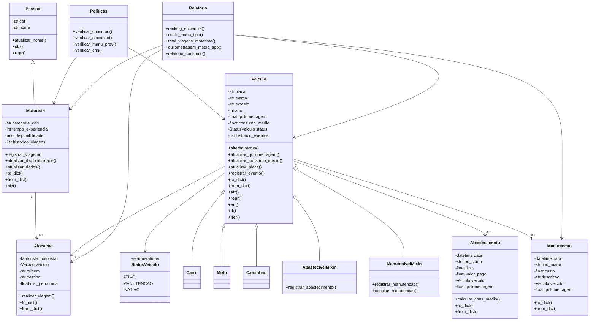

# Sistema de Gerenciamento de Frotas

Projeto desenvolvido para a disciplina de **Programação Orientada a Objetos (POO)** do curso de Engenharia de Software da Universidade Federal do Cariri (UFCA).

## 1. Descrição do projeto

O projeto consiste em um sistema de gerenciamento de frotas de veículos, desenvolvido em Python e executado por meio de uma interface de linha de comando (CLI).

O sistema permite cadastrar e administrar veículos e motoristas, registrar viagens, abastecimentos e manutenções, além de consultar relatórios relacionados ao desempenho e aos custos da frota.

A implementação utiliza conceitos de Programação Orientada a Objetos, como:

- Encapsulamento;
- Herança simples;
- Herança múltipla;
- Polimorfismo;
- Classes abstratas de comportamento por meio de mixins;
- Métodos especiais;
- Persistência de dados em arquivos JSON;
- Tratamento de exceções;
- Aplicação de regras de negócio configuráveis.

## 2. Funcionalidades

### Gerenciamento de veículos
- Cadastro de carros, motos e caminhões;
- Listagem dos veículos cadastrados;
- Atualização da placa;
- Exclusão de veículos sem histórico associado;
- Controle de quilometragem;
- Controle de status: ativo, manutenção ou inativo.

### Gerenciamento de motoristas
- Cadastro e listagem de motoristas;
- Atualização dos dados cadastrais;
- Controle de categoria da CNH;
- Controle de experiência e disponibilidade;
- Registro do histórico de viagens;
- Exclusão condicionada à ausência de histórico.

### Viagens e alocações
- Associação de um motorista a um veículo;
- Registro de origem e destino;
- Registro da distância percorrida;
- Atualização automática da quilometragem do veículo;
- Verificação das regras de disponibilidade, status do veículo e compatibilidade da CNH.

### Abastecimentos
- Registro da data e do tipo de combustível;
- Registro da quantidade de litros e do valor pago;
- Associação do abastecimento a um veículo;
- Armazenamento da quilometragem no momento do registro;
- Cálculo do consumo médio com base no histórico de abastecimentos.

### Manutenções
- Registro de manutenções preventivas e corretivas;
- Armazenamento da data, custo, descrição e quilometragem;
- Alteração automática do status do veículo para manutenção;
- Conclusão da manutenção e retorno do veículo ao status ativo.

### Relatórios
O sistema disponibiliza relatórios de:

- Ranking de eficiência dos veículos;
- Custos de manutenção por tipo de veículo;
- Quantidade de viagens por motorista;
- Quilometragem total e média por tipo de veículo;
- Consumo dos veículos fora da faixa configurada.

## 3. Organização do projeto

```text
MiniProjeto---POO/
│
├── data/
│   ├── veiculos.json
│   ├── motoristas.json
│   ├── alocacoes.json
│   ├── abastecimentos.json
│   └── manutencoes.json
│
├── src/
│   ├── __init__.py
│   ├── veiculo.py
│   ├── pessoa.py
│   ├── alocacao.py
│   ├── abastecimento.py
│   ├── manutencao.py
│   ├── politicas.py
│   ├── relatorio.py
│   ├── persistencia_json.py
│   ├── abastecivel_mixin.py
│   ├── manutenivel_mixin.py
│   ├── excecoes.py
│   └── seed.py
│
├── testes/
│   ├── test_veiculos.py
│   ├── test_pessoa.py
│   ├── test_persistencia.py
│   ├── test_politicas.py
│   └── test_relatorio.py
│
├── main.py
├── settings.json
├── requirements.txt
└── README.md
```

### Principais módulos

| Módulo | Responsabilidade |
|---|---|
| `veiculo.py` | Classes de veículos, status e histórico de eventos. |
| `pessoa.py` | Classes Pessoa e Motorista. |
| `alocacao.py` | Associação entre motorista e veículo e realização de viagens. |
| `abastecimento.py` | Registro e cálculo de consumo dos abastecimentos. |
| `manutencao.py` | Registro de manutenções. |
| `politicas.py` | Regras de negócio e validações. |
| `relatorio.py` | Geração dos relatórios da frota. |
| `persistencia_json.py` | Salvamento e carregamento dos dados JSON. |
| `abastecivel_mixin.py` | Comportamentos relacionados aos abastecimentos. |
| `manutenivel_mixin.py` | Comportamentos relacionados às manutenções. |
| `excecoes.py` | Exceções personalizadas do sistema. |
| `seed.py` | Inicialização dos dados demonstrativos. |

## 4. Modelagem orientada a objetos

### Veículo

A classe `Veiculo` representa a classe-base dos veículos da frota.

**Atributos:**
- Placa;
- Marca;
- Modelo;
- Ano;
- Quilometragem;
- Consumo médio;
- Status;
- Histórico de eventos.

**Principais métodos:**
- `alterar_status()`;
- `atualizar_quilometragem()`;
- `atualizar_consumo_medio()`;
- `atualizar_placa()`;
- `registrar_evento()`;
- `to_dict()` e `from_dict()`.

A classe possui três subclasses:

- `Carro`;
- `Moto`;
- `Caminhao`.

Cada subclasse define seu próprio tipo de veículo e herda os atributos e comportamentos da classe `Veiculo`.

### Pessoa e Motorista

A classe `Pessoa` representa uma pessoa cadastrada no sistema, contendo CPF e nome.

A classe `Motorista` herda de `Pessoa` e acrescenta:

- Categoria da CNH;
- Tempo de experiência;
- Disponibilidade;
- Histórico de viagens.

Entre seus métodos estão `registrar_viagem()`, `atualizar_disponibilidade()` e `atualizar_dados()`.

### Alocação

A classe `Alocacao` relaciona um motorista a um veículo para registrar uma viagem.

Armazena:
- Motorista;
- Veículo;
- Origem;
- Destino;
- Distância percorrida.

O método `realizar_viagem()` verifica as políticas de alocação, atualiza a quilometragem do veículo e registra a viagem nos históricos correspondentes.

### Abastecimento

A classe `Abastecimento` armazena:
- Data;
- Tipo de combustível;
- Litros abastecidos;
- Valor pago;
- Veículo relacionado;
- Quilometragem no momento do abastecimento.

Também possui o método `calcular_cons_medio()`, responsável pelo cálculo do consumo médio com base nos registros disponíveis.

### Manutenção

A classe `Manutencao` armazena:
- Data;
- Tipo de manutenção;
- Custo;
- Descrição;
- Veículo relacionado;
- Quilometragem no momento do registro.

As manutenções podem ser preventivas ou corretivas.

### Mixins

O projeto utiliza herança múltipla para compartilhar comportamentos entre as subclasses de veículos.

**AbastecivelMixin**

Responsável pelo registro de abastecimentos e pela atualização do consumo médio do veículo.

**ManutenivelMixin**

Responsável pelo registro de manutenções, alteração do status do veículo e conclusão da manutenção.

Assim, `Carro`, `Moto` e `Caminhao` herdam de `Veiculo`, `ManutenivelMixin` e `AbastecivelMixin`.

### Políticas

A classe `Politicas` centraliza as regras de negócio, incluindo:

- Verificação da faixa de consumo;
- Verificação da disponibilidade do motorista;
- Verificação do status do veículo;
- Compatibilidade entre categoria da CNH e tipo de veículo;
- Verificação do limite de quilometragem para manutenção preventiva.

### Relatório

A classe `Relatorio` recebe as listas de motoristas, alocações e veículos e disponibiliza os métodos:

- `ranking_eficiencia()`;
- `custo_manu_tipo()`;
- `total_viagens_motorista()`;
- `quilometragem_media_tipo()`;
- `relatorio_consumo()`.

## 5. Diagrama UML



## 6. Configurações do sistema

As regras configuráveis ficam no arquivo `settings.json`.

Configuração atual:

- Limite para revisão preventiva: `10000` km;
- Faixa de consumo: entre `5.0` e `30.0` km/L;
- Compatibilidade de CNH:
  - Carro: categoria B;
  - Moto: categoria A;
  - Caminhão: categorias C, D ou E.

O arquivo também contém valores de referência para custos de manutenção preventiva e corretiva.

## 7. Persistência dos dados

O sistema utiliza arquivos JSON para armazenar os dados cadastrados.

Os arquivos ficam dentro da pasta `data/`:

| Arquivo | Dados armazenados |
|---|---|
| `veiculos.json` | Veículos cadastrados. |
| `motoristas.json` | Motoristas cadastrados e seus históricos. |
| `alocacoes.json` | Viagens e associações entre motoristas e veículos. |
| `abastecimentos.json` | Registros de abastecimento. |
| `manutencoes.json` | Registros de manutenção. |

A classe `JsonRepository`, localizada em `persistencia_json.py`, centraliza as operações de salvamento e carregamento.

Os métodos `to_dict()` e `from_dict()` permitem converter os objetos para estruturas compatíveis com JSON e reconstruí-los durante o carregamento.

As relações entre objetos são preservadas por meio de identificadores, como CPF do motorista e placa do veículo.

Os arquivos JSON são inicializados com listas vazias. Na primeira execução, o módulo `seed.py` cadastra os dados demonstrativos de veículos e motoristas quando ambos os cadastros estão vazios.

## 8. Como executar o projeto

### Requisitos

- Python 3;
- Git (opcional, para clonar o repositório);
- Pytest para executar os testes automatizados.

### Clonando o repositório

```bash
git clone https://github.com/arthurbarrosdesa/MiniProjeto---POO.git
cd MiniProjeto---POO
```

### Instalando as dependências

```bash
pip install -r requirements.txt
```

### Executando o sistema

O sistema é executado pelo arquivo `main.py`.

Para visualizar a lista de comandos disponíveis:

```bash
python main.py --help
```

Para consultar os argumentos de um comando específico, utilize `--help` após o comando.

Exemplo:

```bash
python main.py cadastrar-veiculo --help
```

## 9. Comandos disponíveis

### Listagem

```bash
python main.py listar-veiculos
python main.py listar-motoristas
python main.py listar-alocacoes
python main.py listar-abastecimentos
python main.py listar-manutencoes
```

### Cadastro de veículos

```bash
python main.py cadastrar-veiculo --tipo carro --placa ABC1D23 --marca Toyota --modelo Corolla --ano 2022 --consumo-medio 12.5
```

O argumento `--tipo` aceita:
- `carro`;
- `moto`;
- `caminhao`.

### Cadastro de motoristas

```bash
python main.py cadastrar-motorista --cpf 12345678900 --nome "João Silva" --categoria-cnh B --tempo-experiencia 5
```

### Cadastro de alocações

```bash
python main.py cadastrar-alocacao --cpf 12345678900 --placa ABC1D23 --origem Fortaleza --destino Caucaia --dist-percorrida 20
```

### Cadastro de abastecimentos

```bash
python main.py cadastrar-abastecimento --data 2026-11-03 --tipo-comb gasolina --litros 30 --valor-pago 150 --placa ABC1D23
```

A data deve ser informada em formato compatível com ISO 8601, como `AAAA-MM-DD`.

### Cadastro de manutenções

```bash
python main.py cadastrar-manutencao --data 2026-11-03 --tipo-manu preventiva --custo 300 --placa ABC1D23 --descricao "Troca de óleo"
```

O argumento `--tipo-manu` aceita:
- `preventiva`;
- `corretiva`.

### Atualização de veículos

```bash
python main.py atualizar-veiculo --placa-atual ABC1D23 --nova-placa XYZ9A87
```

### Exclusão de veículos

```bash
python main.py excluir-veiculo --placa ABC1D23
```

Veículos com histórico de viagens, abastecimentos ou manutenções não podem ser excluídos. O sistema preserva esses registros históricos.

### Atualização de motoristas

```bash
python main.py atualizar-motorista --cpf 12345678900 --nome "João Silva" --categoria-cnh B --experiencia 6 --disponibilidade sim
```

O argumento `--disponibilidade` aceita `sim`, `não`, `true`, `false`, `1` ou `0`.

### Exclusão de motoristas

```bash
python main.py excluir-motorista --cpf 12345678900
```

Motoristas com histórico de viagens não podem ser excluídos.

### Conclusão de manutenção

```bash
python main.py concluir-manutencao --placa ABC1D23
```

O comando conclui a manutenção e retorna o status do veículo para ativo, desde que ele esteja em manutenção.

## 10. Relatórios

O sistema disponibiliza cinco relatórios:

### Ranking de eficiência

```bash
python main.py relatorios eficiencia
```

Apresenta os veículos ordenados pelo consumo médio, do maior para o menor.

### Custos de manutenção

```bash
python main.py relatorios custos-manutencao
```

Apresenta a quantidade de manutenções, o custo total e o custo médio por tipo de veículo.

### Total de viagens por motorista

```bash
python main.py relatorios viagens
```

Apresenta a quantidade de viagens registradas para cada motorista.

### Quilometragem por tipo de veículo

```bash
python main.py relatorios quilometragem
```

Apresenta a quantidade de veículos, a quilometragem total e a média por categoria.

### Relatório de consumo

```bash
python main.py relatorios consumo
```

Apresenta os veículos cujo consumo médio está fora da faixa configurada no arquivo `settings.json`.

## 11. Testes automatizados

O projeto utiliza Pytest para verificar o funcionamento das classes e das regras implementadas.

Os testes estão organizados na pasta `testes/` e abrangem:

- Criação e validação de veículos;
- Herança de veículos e motoristas;
- Atualização de atributos;
- Registro de eventos e viagens;
- Persistência e carregamento de dados JSON;
- Regras de alocação;
- Validação de abastecimentos e manutenções;
- Geração de relatórios.

Para executar todos os testes:

```bash
pytest -q
```

Na última verificação do projeto, foram aprovados **32 testes**.

## 12. Considerações finais

O projeto aplica conceitos de Programação Orientada a Objetos em um sistema prático de gerenciamento de frotas.

A separação entre entidades, regras de negócio, persistência e interface de linha de comando permite organizar as responsabilidades do sistema e facilita futuras extensões, como a inclusão de novas categorias de veículos, relatórios e funcionalidades administrativas.
### Persistência dos dados

Os dados cadastrados são armazenados em arquivos JSON na pasta `data/`, permitindo que as informações sejam recuperadas entre execuções do sistema.

As configurações das regras de negócio são armazenadas no arquivo `settings.json`.
